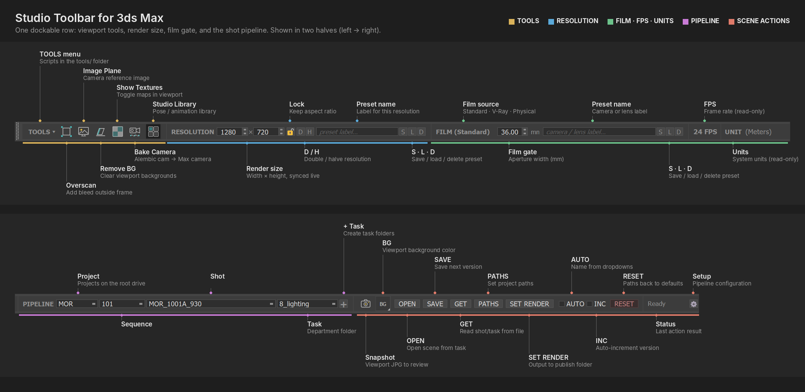

# Studio Toolbar for 3ds Max

[](https://www.autodesk.com/products/3ds-max/)     [](https://github.com/javibravo-vfx/StudioToolbar-houdini) [](https://github.com/javibravo-vfx/StudioToolbar-maya) [](https://github.com/javibravo-vfx/StudioToolbar-blender)

A dockable pipeline toolbar for **3ds Max** built with Python / PySide6.  
Designed for VFX studios — manages resolution, film size, FPS, pipeline navigation, and shot actions from a single persistent dock.



---

## Features

| Section | What it does |
|---|---|
| **Tools** | Quick-launch buttons: Overscan, Image Plane, Remove Background, **Paste Cam** (creates the camera copied from 3D Camera Pin), **Lookdev Rig** (camera, chrome/grey balls, colour chart, shadow catcher and HDRI dome turntable around the selection; uses a selected camera's framing; clay toggle; live HDRI swap / rotation / exposure; library thumbnails), Studio Library — plus a **TOOLS ▾** menu with Show Textures, Bake Camera and every script in `tools/` (subfolders become submenus). Right-click the toolbar background for Show Textures / Bake Camera / Pipeline Setup |
| **Resolution** | W×H spinners, live aspect ratio, aspect lock, ×2 / ½. Preset list (arrow inside the label field) with your saved presets and standard formats (HD, UHD, DCI 2K/4K, Scope, square, vertical…) |
| **Film gate** | Reads/writes aperture for Standard, V-Ray and Physical cameras. Preset list includes common cinema sensor widths (ARRI Alexa 35 / Mini / Mini LF, RED V-Raptor / Komodo, Sony Venice 2, Blackmagic, Super 35…) |
| **FPS / Units** | Live sync; click FPS to switch frame rate |
| **Pipeline** | Project → Sequence → Shot → Task dropdowns from the filesystem, **+** to create task folders, folder button to open shot / task / subfolders in Explorer |
| **Viewport Snapshot** | Saves a `.jpg` of the active viewport — configurable filename parts and destination. Right-click opens the snapshots folder |
| **Actions** | **OPEN ▾** (browse, or pick a recent version of the task) · **SAVE ▾** (dialog, or save next version in one click) · **GET** (reads shot/task from the open file — glows amber when the dropdowns don't match the open file) · **PATHS** (project paths, stored in the .max and restored on open) · **SET RENDER** (publish output incl. render elements / V-Ray / Arnold; asks before overwriting) · **RESET** |
| **Status** | Coloured result of the last action; click for a history with full paths (click an entry to copy) |
| **Setup** | Full pipeline config dialog with preset save/load |

---

## Requirements

- **3ds Max 2024+** (PySide6)
- **pymxs** + **qtmax** (bundled with Max)
- Python 3.x (bundled with Max)

---

## Installation

1. **Copy the repo to your studio drive**, e.g.:
   ```
   T:\.studio-toolbar\max\
   ```
   (`dev/` and `docs/` are not needed there.)

2. **Make it start with 3ds Max** — copy `startup/StudioToolbar-max_Start.ms` into a Max startup folder:

   | Scope | Folder |
   |---|---|
   | Per user (no admin) | `%LOCALAPPDATA%\Autodesk\3dsMax\<version> - 64bit\ENU\scripts\startup\` |
   | All users (admin) | `C:\Program Files\Autodesk\3ds Max <version>\scripts\Startup\` |

   Restart Max — the toolbar docks at the top. If the toolbar lives somewhere other than
   `T:\.studio-toolbar\max\`, edit `TOOLBAR_PATH` inside the startup file.

3. **Configure your pipeline** with the ⚙ Setup button (root drive, project prefix, tasks, folders,
   snapshots). Settings are saved per user in `%USERPROFILE%\.studio-toolbar\`.
   The **USER CONFIG** block at the top of `StudioToolbar-max.py` only holds the defaults used
   the first time, and the paths to the helper scripts if you move them:
   ```python
   PATH_OVERSCAN  = r"T:\.studio-toolbar\max\maintools\STM_Overscan.ms"
   PATH_TOOLS_DIR = r"T:\.studio-toolbar\max\tools"
   ```

To launch it manually instead (e.g. to test a new version):
```maxscript
python.ExecuteFile @"T:\.studio-toolbar\max\StudioToolbar-max.py"
```

---

## Folder Structure

```
StudioToolbar-max.py     ← main script (run this)
maintools/               ← MAXScript helpers called by toolbar buttons
  STM_Overscan.ms
  STM_ImagePlane.ms
  STM_RemoveBack.ms
  STM_ShowTextures.ms
  STM_BakeAlembic.ms
  STM_StudioLibraryMAX.py
  STM_LookdevRig.py      ← Lookdev Rig launcher
  studio_lookdev_max/    ← Lookdev Rig: builder, dialog, render-engine adapters (vray, arnold, stubs)
tools/                   ← optional extra tools
  STM_CarRig.ms
  STM_SuperAttach.ms
startup/                 ← copy into a Max scripts\startup folder (see Installation)
  StudioToolbar-max_Start.ms
docs/                    ← screenshots and documentation (not needed on the studio drive)
dev/                     ← offline test harness (not needed on the studio drive)
```

### Lookdev Rig shared data

The Lookdev Rig reads data shared by every DCC toolbar, outside this repo:

```
T:\.studio-toolbar\shared\
  lookdev\hdri\        ← drop HDRIs here (.exr/.hdr) + optional name.json sidecar + name.jpg thumbnail
  lookdev\hdri\_cache\ ← generated by Refresh library: name.thumb.jpg, name.bg.exr (blurred background)
  lookdev\presets\     ← turntable_default.json (framing, refs, turntable timing)
  lookdev\reference\   ← colorchecker24.json
  python\studio_lookdev\core.py   ← DCC-agnostic framing / layout / colour math
  python\studio_lookdev\library.py ← library maintenance (thumbnails, blurred backgrounds, .tx)
```

If the shared folder is missing, the Lookdev button says so. Use `STUDIO_TOOLBAR_ROOT` to point elsewhere.

---

## Pipeline Config

On first run the toolbar creates `~/.studio-toolbar/` with three files:

| File | Purpose |
|---|---|
| `pipeline_state.ini` | Saves last used resolution/film presets and pipeline state |
| `pipeline_config.ini` | Active pipeline config (written by the Setup ⚙ dialog) |
| `pipeline_presets.json` | Named pipeline presets you save from the Setup dialog |

The **Setup dialog** (⚙ button at the right of the toolbar) lets you configure everything without editing the script — and save/load named presets for different projects or studios.

---

## Expected Folder Structure on Disk

```
T:/
  VFX-MOR/
    101/
      010/
        3D/
          8_lighting/
            1_projects/
            2_review/
            3_publish/
```

---

## Viewport Snapshot

The camera icon button captures the active viewport and saves a `.jpg` to the configured task subfolder.

Filename format is configurable via the Setup dialog — you can toggle which parts are included:
- ☑ Max filename
- ☐ Shot name  
- ☐ Task
- ☑ Camera / view name

Example: `MOR_010_0010_lighting_v003_A_cam_001_v001.jpg`

---

## Version

Current: **v2.6.3**  
See [CHANGELOG.md](CHANGELOG.md) for history.

---

## Author

**Javi Bravo** — VFX / 3D Artist  
